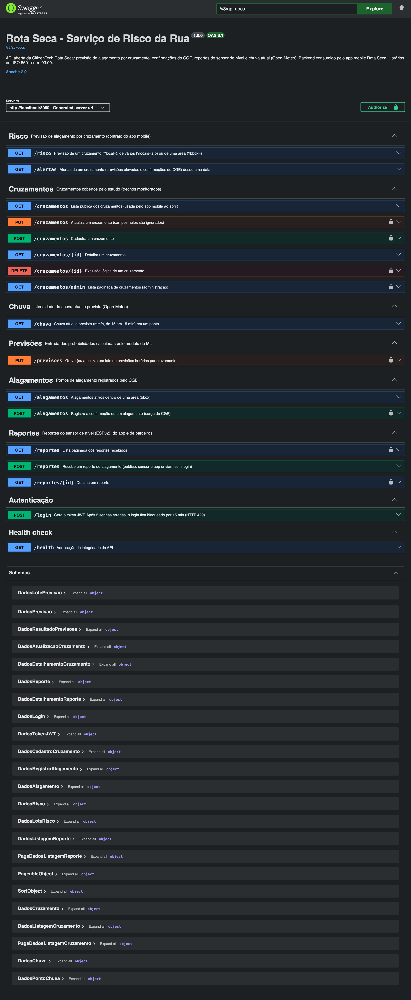
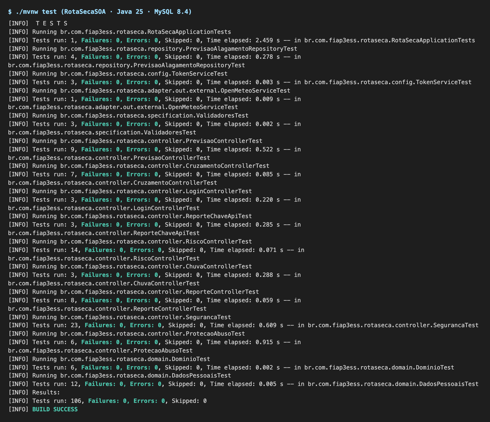
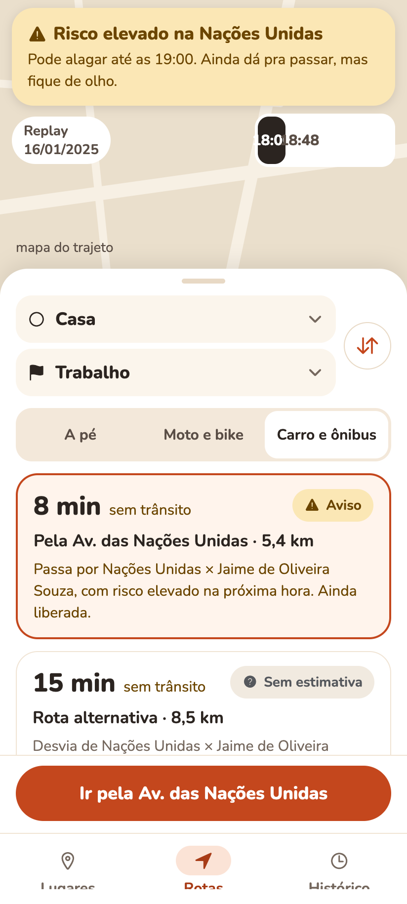
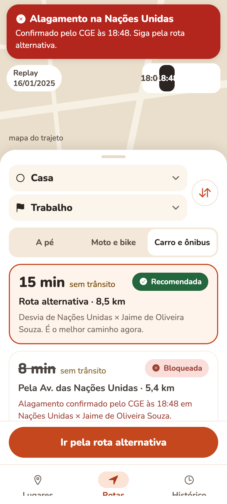
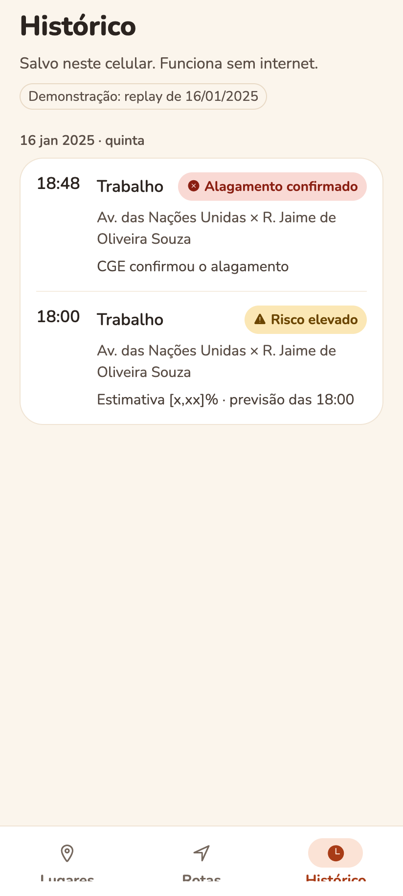
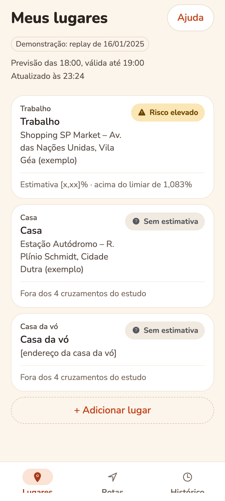
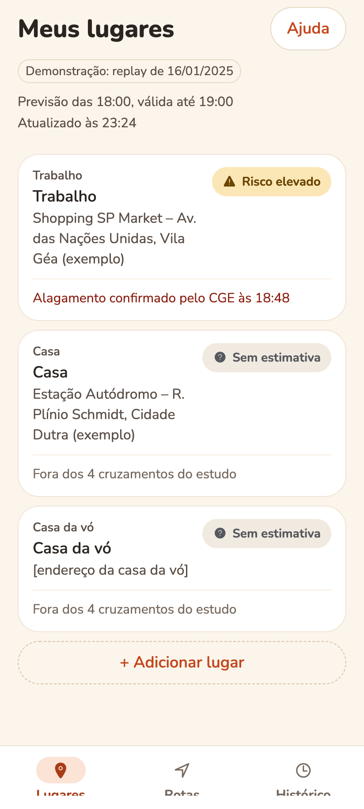

# Rota Seca — Serviço de Risco da Rua (SOA e Web Services)

## Ficha da CitizenTech

| Campo | Conteúdo |
|---|---|
| **Nome** | Rota Seca |
| **Cidade** | São Paulo, SP |
| **Cidadão beneficiado** | Quem se desloca na chuva a pé, de moto, de bicicleta ou de ônibus |
| **Problema** | Ninguém sabe, antes de sair, se o caminho vai alagar |
| **Como funciona** | Estimativa horária por cruzamento, aviso acima de 1,083%, bloqueio só com confirmação do CGE |
| **ODS** | 11 (meta 11.5) e 13 (meta 13.1) |
| **Link do repositório** | https://github.com/matheuscantiere/gs2-soa |

Global Solution FIAP 2026.2 — disciplina **Arquitetura Orientada a Serviços (SOA) e Web Services**.

**Turma:** 3ESS

**Integrantes:**

| Nome | RM |
|---|---|
| Matheus Cantiere | RM558479 |
| Vinicius Castro | RM556137 |
| Guilherme Barbiero | RM555185 |
| Marco Antonio Gonçalves | RM556818 |
| Camila Mie Takara | RM555418 |

---

## O que é

O **Serviço de Risco da Rua** é o backend (API REST aberta) do Rota Seca. Ele guarda os cruzamentos
monitorados, recebe a probabilidade de alagamento calculada pelo modelo de ML, registra as confirmações
de alagamento do CGE, recebe reportes do sensor de nível de água (ESP32) e do app, e consulta a chuva atual
no Open-Meteo. O **app mobile Rota Seca** ([GS02-Mobile](https://github.com/ViniciusCastroo/GS02-Mobile))
consome esta API diretamente (`USE_MOCK = false`).

```
 App Rota Seca (Expo)  ──GET /cruzamentos, /risco, /alertas──►┐
 Sensor ESP32 (Wokwi)  ──POST /reportes──────────────────────►│   Serviço de Risco da Rua
 Modelo de ML          ──PUT /previsoes (JWT ADMIN)──────────►│   Spring Boot 4.0.5 · Java 25
 Admin / carga do CGE  ──POST /alagamentos (JWT ADMIN)───────►│        ├──► MySQL (Flyway)
 Qualquer consumidor   ──GET /risco, /alagamentos, /chuva────►┘        └──► Open-Meteo (job a cada 15 min)
```

Regras do produto (iguais às do app):

- A previsão é **horária** (`previsao_hora` → `valida_ate` = +1 h).
- `estimativa` acima de **1,083% (0.01083)** → `elevado`; igual ou abaixo → `normal`; sem estimativa → `sem_estimativa`.
- A rota só é bloqueada quando o **CGE confirma** (`confirmado_cge = true`); a previsão sozinha só gera aviso.
- Horários sempre em ISO 8601 com **`-03:00`** (nunca `Z`). JSON em `snake_case`.
- Erros sempre no formato `{"erro": {"codigo": "...", "mensagem": "..."}}`.
- Com `em=`, a API responde como teria respondido naquele instante (replay do caso real de **16/01/2025**:
  aviso às 18:00 no cruzamento Av. das Nações Unidas × R. Jaime de Oliveira Souza e alagamento registrado
  pelo CGE às 18:48).

## Tecnologias

| Item | Versão |
|---|---|
| Java | 25 |
| Spring Boot | 4.0.5 (Web MVC, Data JPA, Validation, Security, Flyway) |
| Banco | MySQL 8 + Flyway (`flyway-mysql`) |
| Autenticação | JWT (`com.auth0:java-jwt` 4.6.0) + perfis `ADMIN` / `USER` |
| Documentação | springdoc-openapi 3.1.0 (Swagger UI) |
| API externa | Open-Meteo via `fluent-hc` 4.5.14 + `gson` 2.13.2 |
| Outros | Lombok, Maven Wrapper, Docker Compose |

## Como rodar

### Com Docker (recomendado)

Pré-requisito: **Docker** com Compose. Sobe o MySQL 8.4 e a API juntos (o Flyway aplica as migrações na subida):

```bash
docker compose up -d --build
```

- Parar: `docker compose down` (os dados ficam no volume `db-data`; `docker compose down -v` apaga o banco).
- Logs da API: `docker compose logs -f app`.
- O MySQL fica exposto em `localhost:3306` (usuário `root`, senha `fiap`), então `./mvnw test` roda contra ele.

### Sem Docker

Pré-requisitos: **JDK 25** e **MySQL 8** em `localhost:3306` (usuário `root`, senha `fiap`, ou as variáveis abaixo).

Subir a API (os bancos `rotaseca` e `rotaseca_test` são criados automaticamente e o Flyway aplica as migrações):

```bash
./mvnw spring-boot:run
```

> macOS com mais de um JDK instalado: antes, rode `export JAVA_HOME=$(/usr/libexec/java_home -v 25)`
> (senão o Maven usa outro JDK e falha com "release version 25 not supported").

- Swagger UI: http://localhost:8080/swagger-ui.html
- OpenAPI: http://localhost:8080/v3/api-docs.yaml (cópia em [`SwaggerOffLine.yaml`](SwaggerOffLine.yaml))
- Health check: http://localhost:8080/health

Variáveis de ambiente (todas opcionais):

| Variável | Padrão | Uso |
|---|---|---|
| `DB_USER` / `DB_PASSWORD` | `root` / `fiap` | Credenciais do MySQL |
| `JWT_SECRET` | `12345678` (só desenvolvimento) | Segredo do token JWT. **Em produção é obrigatório** definir 32+ caracteres aleatórios (a API avisa no log se estiver fraco) |
| `JWT_EXPIRACAO_MINUTOS` | `30` | Validade do token |
| `SPRING_PROFILES_ACTIVE` | (vazio) | Use `prod` no servidor: a API **não sobe** se o `JWT_SECRET` for fraco ou o padrão |
| `REPORTES_CHAVE_API` | (vazio) | Se definida, reportes de `SENSOR` e `PARCEIRO` exigem o header `X-Api-Key` com esse valor; o app do cidadão continua sem chave |
| `CHUVA_JOB` | `true` | Liga/desliga a coleta de chuva a cada 15 min |

Usuários de demonstração (criados pela migração V10):

| Login | Senha | Perfil |
|---|---|---|
| `admin` | `admin123` | ADMIN |
| `consulta` | `consulta123` | USER |

No Swagger: `POST /login` → copie o `token` → botão **Authorize** → cole o token.

## Ligando o app mobile

No projeto mobile, em `src/config.ts`:

```ts
export const API_URL = 'http://<IP-da-sua-máquina>:8080'; // no celular físico, não use localhost
export const USE_MOCK = false;
export const MODO_DEMO = true; // replay 16/01/2025 (18:00 → 18:48)
```

Os endpoints usados pelo app são públicos (o app não envia token). CORS liberado para o Expo web (`localhost:8081`).

## Endpoints

| Método | Rota | Acesso | Descrição |
|---|---|---|---|
| GET | `/cruzamentos` | público | Lista dos cruzamentos (formato do app) |
| GET | `/cruzamentos/{id}` | público | Detalhe de um cruzamento |
| GET | `/cruzamentos/admin` | JWT (ADMIN/USER) | Lista paginada |
| POST / PUT | `/cruzamentos` | JWT ADMIN | Cadastra / atualiza |
| DELETE | `/cruzamentos/{id}` | JWT ADMIN | Exclusão lógica |
| GET | `/risco?local={id}[&em=]` | público | Previsão de um cruzamento |
| GET | `/risco?locais={id1},{id2}[&em=]` | público | Previsão em lote (`riscos` + `nao_encontrados`) |
| GET | `/risco?bbox=minLon,minLat,maxLon,maxLat[&em=]` | público | Mapa de risco aberto: risco de cada cruzamento na área |
| GET | `/alertas?local={id}[&desde=]` | público | Previsões elevadas e confirmações do CGE |
| PUT | `/previsoes` | JWT ADMIN | Lote de previsões do modelo de ML (upsert por hora) |
| GET | `/alagamentos?bbox=minLon,minLat,maxLon,maxLat[&desde=]` | público | Alagamentos ativos na área |
| POST | `/alagamentos` | JWT ADMIN | Registra confirmação do CGE |
| POST | `/reportes` | público (30/min por IP) | Reporte do sensor ESP32, do app ou de parceiro |
| GET | `/reportes`, `/reportes/{id}` | JWT ADMIN | Lista paginada / detalhe |
| GET | `/chuva?lat=&lon=` | público | Chuva atual e prevista (Open-Meteo), em mm/h |
| POST | `/login` | público (bloqueio após 5 erros) | Gera o token JWT (30 min) |
| GET | `/health` | público | Health check |

Exemplo — `GET /risco?local=nu-jaime&em=2025-01-16T18:48:00-03:00`:

```json
{
  "local_id": "nu-jaime",
  "cruzamento": "Av. das Nações Unidas × R. Jaime de Oliveira Souza",
  "previsao_hora": "2025-01-16T18:00:00-03:00",
  "valida_ate": "2025-01-16T19:00:00-03:00",
  "estimativa": null,
  "limiar": 0.01083,
  "status": "elevado",
  "confirmado_cge": true,
  "confirmado_em": "2025-01-16T18:48:00-03:00"
}
```

Exemplo de reporte do sensor (`POST /reportes`):

```json
{ "origem": "SENSOR", "local_id": "nu-jaime", "latitude": -23.6814075, "longitude": -46.694591, "nivel_cm": 22 }
```

Resposta 201 com `"faixa": "intransitavel_a_pe"` (`< 5` cm seco, `5–14` lâmina, `≥ 15` intransitável a pé).

Códigos de erro: `local_nao_encontrado` (404), `requisicao_invalida` (415/406), `muitas_tentativas` (429, com `Retry-After`), `chave_api_invalida` (401), `nao_encontrado` (404), `parametro_invalido` (400),
`validacao` (400, com `campos`), `reporte_duplicado` (409), `conflito` (409), `credenciais_invalidas` (401),
`nao_autenticado` (401), `token_invalido` (401), `acesso_negado` (403), `servico_externo_indisponivel` (502).

## Segurança

| Proteção | Como funciona |
|---|---|
| Autenticação | JWT (HMAC-256, emissor `RotaSecaSOA`) com validade de 30 min, calculada em UTC (vale em qualquer fuso do servidor) |
| Autorização | Perfis `ADMIN` e `USER` com `@PreAuthorize`; endpoints do app e da API aberta são públicos (só leitura, mais o `POST /reportes`) |
| Token inválido | Expirado, assinado com outro segredo, de outro emissor, `alg: none` ou de usuário inexistente → 401 `token_invalido` |
| Força bruta no login | 5 senhas erradas por IP + login bloqueiam por 15 min (429 com `Retry-After`); a resposta não revela se o usuário existe |
| Abuso do `POST /reportes` | Até 30 requisições por minuto por IP (429); duplicata da mesma origem no mesmo cruzamento ou num raio de ~110 m em 5 min (409); chave `X-Api-Key` opcional para sensor e parceiro |
| Dado pessoal | CPF, telefone, e-mail e placa na descrição do reporte viram `[removido]` antes de gravar (`dados_removidos: true` na resposta); reportes só são listados para `ADMIN` |
| Segredo | `JWT_SECRET` por variável de ambiente; no perfil `prod` a API não sobe com segredo fraco |

Limitações conhecidas: os contadores de tentativas ficam na memória de uma instância (com várias instâncias, usar Redis);
a remoção de dado pessoal cobre padrões simples, e a análise completa (nomes, endereços) é do módulo de Cybersecurity.

## Arquitetura do código

Arquitetura hexagonal, no mesmo padrão do projeto da disciplina:

```
src/main/java/br/com/fiap3ess/rotaseca
├── adapter
│   ├── in/controller      Controllers REST, DTOs (request/response) e mappers
│   ├── in/scheduler       Job de coleta de chuva (@Scheduled, 15 min)
│   └── out
│       ├── repository     Entities JPA, EntityMappers, Spring Data e implementações das portas
│       ├── external       OpenMeteoService (fluent-hc + gson)
│       └── security       AutenticacaoService (UserDetailsService)
├── application
│   ├── core/domain        Cruzamento, Previsao, Alagamento, Reporte, LeituraChuva (domínio puro), Usuario
│   ├── core/specification Validadores de reporte e de previsão (injetados como List<>)
│   ├── port/in, port/out  StdFeaturesPort e interfaces de repositório / provedor de chuva
│   └── service            Regras de aplicação (risco, previsões, alagamentos, reportes, chuva)
├── config                 Segurança (JWT, CORS, filtro) e Swagger
├── exception              GlobalExceptionHandler + exceções de domínio
└── shared                 Horario (fuso -03:00), enums
```

Mapeamento com as entidades da proposta: **Cruzamento** ≈ Trecho, **Previsao** ≈ ProbabilidadeTrecho,
**Alagamento** ≈ PontoAlagamento, **LeituraChuva** ≈ LeituraChuva, **Reporte** ≈ LeituraSensor + ReporteExterno.

## Banco de dados e migrações

| Versão | Migração |
|---|---|
| V1 | `create-table-cruzamentos` |
| V2 | `create-table-previsoes` (unique cruzamento + hora) |
| V3 | `create-table-alagamentos` |
| V4 | `create-table-reportes` |
| V5 | `create-table-usuarios` |
| V6 | `alter-table-usuarios-add-column-perfil` |
| V7 | `alter-table-cruzamentos-add-column-ordem` |
| V8 | `insert-cruzamentos` (4 cruzamentos do estudo) |
| V9 | `insert-replay-16-01-2025` (aviso 18:00 + confirmação CGE 18:48) |
| V10 | `insert-usuarios` (admin e consulta, senhas BCrypt) |
| V11 | `create-table-leituras-chuva` |

## Testes automatizados

```bash
./mvnw test
```

106 testes (precisam do MySQL em `localhost:3306`, local ou o do `docker compose`; usam o banco `rotaseca_test` com rollback por teste). A suíte passa com o
servidor em `America/Sao_Paulo` e em `UTC` (`./mvnw test -DargLine="-Duser.timezone=UTC"`), como numa VM Linux:

| Classe | O que cobre |
|---|---|
| `RiscoControllerTest` | Contrato com o app: JSON idêntico ao mock, replay 18:00/18:30/18:48, lote, erros 400/404, fuso -03:00, alertas |
| `CruzamentoControllerTest` | Lista pública, CRUD com perfis (401/403/201/409), validação, exclusão lógica, paginação |
| `ReporteControllerTest` | Reporte do sensor, validações, duplicado (409), listagem protegida |
| `PrevisaoControllerTest` | Entrada do ML, limiar estrito, upsert, validações, alagamento confirmando o risco, bbox |
| `LoginControllerTest` | Login, senha errada, token inválido (401, nunca 500) |
| `SegurancaTest` | Com tokens reais: rotas protegidas sem token (401), rotas públicas, perfis USER/ADMIN (403/200), expiração em 30 min independente do fuso, token expirado, assinado com outro segredo, de outro emissor, `alg: none` e de usuário inexistente (401), login sem revelar usuário, Content-Type errado (415) |
| `ProtecaoAbusoTest` | Bloqueio de login após 5 erros (429, mesmo com a senha certa), limite de 30 reportes/min por IP, duplicata por coordenada, remoção de dado pessoal da descrição |
| `ReporteChaveApiTest`, `TokenServiceTest`, `DadosPessoaisTest` | Chave do sensor (`X-Api-Key`), recusa de subir em `prod` com segredo fraco, regras de CPF/telefone/e-mail/placa sem falso positivo |
| `ChuvaControllerTest` | `/chuva` com o Open-Meteo mockado, 502 quando ele cai |
| `PrevisaoAlagamentoRepositoryTest` | `@DataJpaTest` das consultas JPQL (janela da previsão, confirmação, bbox) |
| `DominioTest`, `ValidadoresTest`, `OpenMeteoServiceTest` | Regras puras, specifications e conversão do Open-Meteo |

## Evidências

Veja [`evidencias/`](evidencias/):

- [`chamadas.md`](evidencias/chamadas.md): respostas reais de todos os endpoints, histórico do Flyway e a API
  rodando com `docker compose` (seção "Rodando com Docker").
- **Swagger UI** ([`swagger.png`](evidencias/swagger.png)) com chamadas executadas:
  [`swagger-risco-18h48.png`](evidencias/swagger-risco-18h48.png) (replay 18:48),
  [`swagger-login.png`](evidencias/swagger-login.png) e
  [`swagger-previsoes-autenticado.png`](evidencias/swagger-previsoes-autenticado.png) (Authorize com JWT + `PUT /previsoes`).
- **Testes automatizados** ([`testes.png`](evidencias/testes.png)): `./mvnw test` com 106 testes, BUILD SUCCESS.




### Integração com o app mobile

As telas abaixo **não fazem parte deste repositório**: são do app **Rota Seca**, desenvolvido na disciplina de
Mobile (Expo/React Native) no repositório [GS02-Mobile](https://github.com/ViniciusCastroo/GS02-Mobile).
Os dois projetos formam a mesma solução da Global Solution: esta API (SOA) é o backend e o app é o cliente
que a consome. Este repositório tem só o backend em Java; o app fica apenas no repositório de Mobile.

Nos prints, o app estava com `USE_MOCK = false`, apontando para esta API, e chamou `GET /cruzamentos` e
`GET /risco?local=nu-jaime&em=…` no backend. Os prints servem como evidência de que a API é consumida por
um cliente real.

| Rotas 18:00 (aviso) | Rotas 18:48 (bloqueada pelo CGE) | Histórico |
|---|---|---|
|  |  |  |

| Meus Lugares 18:00 | Meus Lugares 18:48 |
|---|---|
|  |  |

## Fontes de dados

- **OpenStreetMap (Nominatim)** — posição do cruzamento Av. das Nações Unidas × R. Jaime de Oliveira Souza
  (`-23.6814075, -46.694591`, ways 251265978 × 941850957, Vila Géa).
- **CGE-SP** — registro do alagamento de 16/01/2025 às 18:48.
- **Open-Meteo** — chuva atual e prevista (API pública, sem chave).
- Nenhum dado pessoal real: usuários e reportes são de demonstração.

## Uso de IA

Prompts usados no desenvolvimento: [`prompts.md`](prompts.md).
